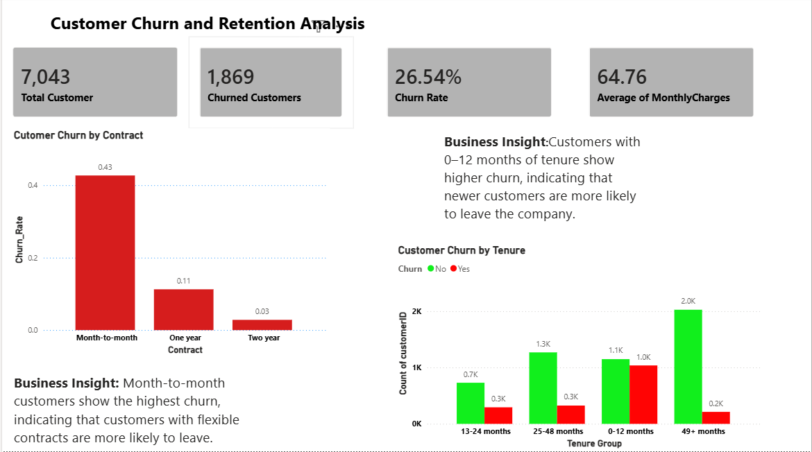
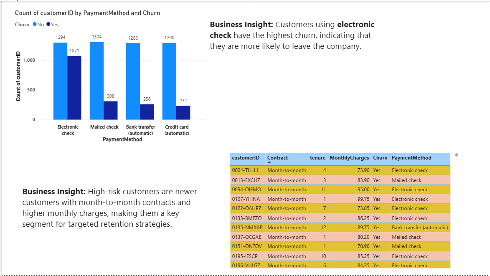

# Customer Churn & Retention Analysis

## Project Overview

This project analyzes customer churn to identify patterns and customer segments that are more likely to leave a telecom service.

The analysis follows a practical data analytics workflow:

**Data Cleaning → Exploratory Analysis → SQL Analysis → Power BI Dashboard → Business Insights**

## Objective

The main objectives of this project are to:

- Understand the overall customer churn rate
- Compare churn across different contract types
- Analyze churn based on customer tenure
- Identify payment methods associated with higher churn
- Compare average monthly charges between churned and retained customers
- Identify a high-risk customer segment for retention strategies

## Tools & Technologies

- **Python** — Data cleaning and exploratory analysis
- **Pandas & NumPy** — Data manipulation and preprocessing
- **PostgreSQL / SQL** — Data analysis and customer segmentation
- **Power BI** — Dashboard creation and business insights

## Dataset

The project uses a telecom customer churn dataset containing customer information such as:

- Customer demographics
- Tenure
- Contract type
- Internet service
- Payment method
- Monthly charges
- Total charges
- Churn status

The cleaned dataset is included in this repository.

## Key Analysis

### Python

Python was used to:

- Inspect the dataset
- Check missing values and duplicates
- Clean the `TotalCharges` column
- Convert data types
- Calculate basic churn statistics
- Prepare the cleaned dataset for further analysis

### SQL

PostgreSQL was used to analyze:

- Total number of customers
- Churned vs retained customers
- Overall churn rate
- Churn by contract type
- Churn rate by contract
- Churn by payment method
- Churn by tenure group
- Average monthly charges by churn status
- High-risk churned customers

### Power BI

The Power BI dashboard contains two pages:

**Page 1 — Customer Churn Overview**

- Total Customers
- Churned Customers
- Churn Rate
- Average Monthly Charges
- Churn by Contract
- Churn by Tenure

**Page 2 — Churn Drivers & Risk Analysis**

- Churn by Payment Method
- High-Risk Churned Customers
- Business insights and retention-focused analysis

## Key Business Insights

- Month-to-month customers show the highest churn, indicating that they are more likely to leave.
- Customers with 0–12 months of tenure show higher churn, indicating that newer customers are more likely to leave.
- Electronic check customers have the highest churn among the payment methods analyzed.
- High-risk churned customers include newer customers with month-to-month contracts and higher monthly charges.

These findings can help businesses focus retention efforts on customers who are more likely to churn.

## Project Structure

```text
customer-churn-retention-analysis/
│
├── Python analysis file
├── SQL analysis file
├── customer_churn_clean.csv
├── dashboard_overview.png
├── churn_drivers_risk.png
└── README.md
```

## Dashboard Preview

### Customer Churn Overview



### Churn Drivers & Risk Analysis



## Conclusion

This project demonstrates an end-to-end data analytics workflow using Python, SQL, PostgreSQL, and Power BI to analyze customer churn and identify potential retention opportunities.
